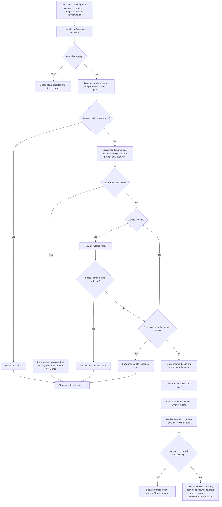

# FlowAlgo Workflow

A user enters process notes in FlowAlgo or loads a template, then clicks Generate Flowchart. The browser and the Next.js server both check for empty notes, and the server then sends the notes with a business-analyst prompt to the Claude API, retrying on a fallback model if Claude refuses. Failures such as API errors, a model refusal on both models, or a cut-off or invalid JSON response are shown in the red error box. On success the result is saved to History, the summary appears in the Process Overview card, and the Mermaid diagram is rendered, with a syntax error shown if rendering fails, otherwise the user can download, copy, view code, start over, or reopen past flowcharts.

_Generated by FlowAlgo itself._
