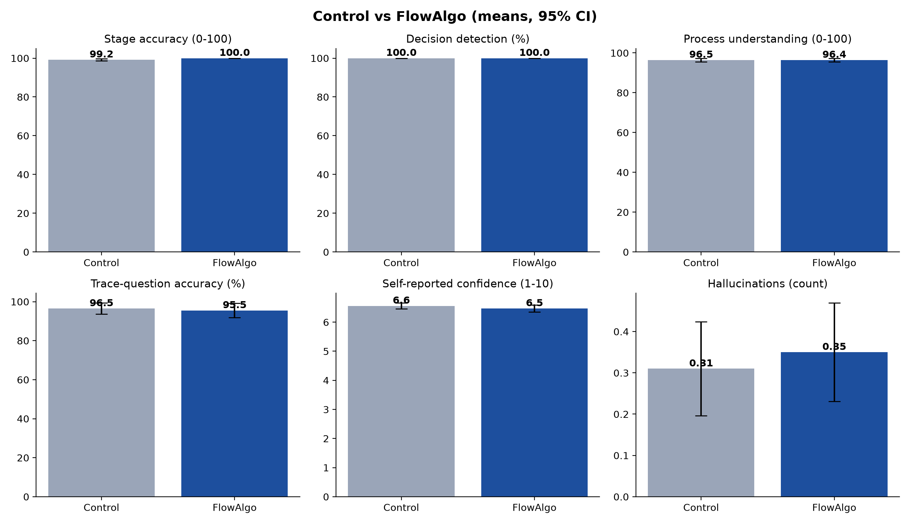
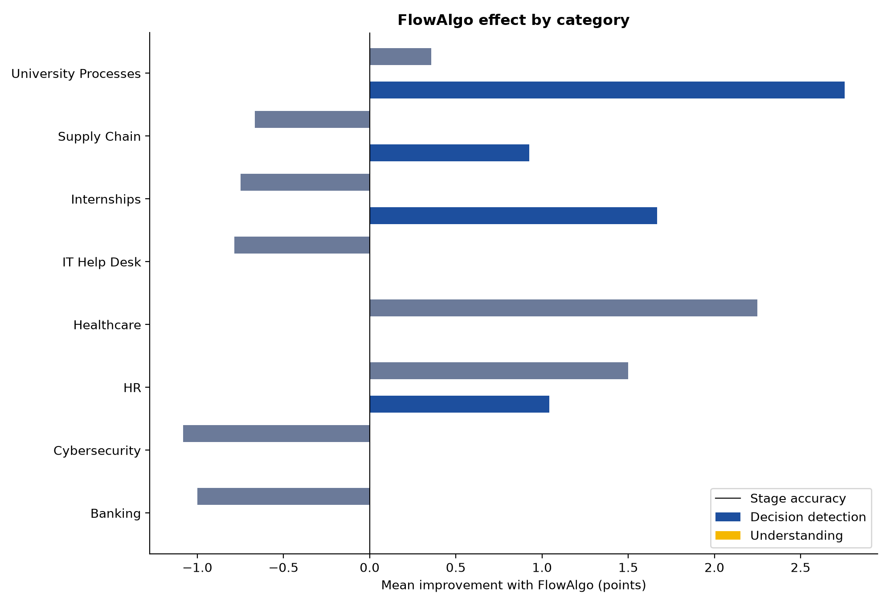
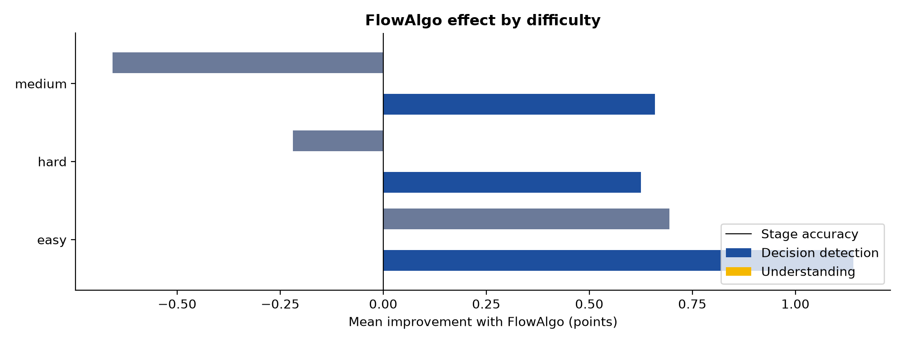

# FlowAlgo Agent-Based Pilot Evaluation

50 scenarios x 2 personas x 2 conditions = 200 graded trials (100 paired comparisons).

Each simulated student answered every scenario twice: once with the workflow text only (control), and once with the workflow text plus the FlowAlgo diagram. Differences are FlowAlgo minus control, paired by scenario and persona. p-values are paired t-tests with Holm correction across the six metrics.

## Overall

| Metric | Control | FlowAlgo | Difference [95% CI] | Effect size (dz) | p (Holm) |
|---|---:|---:|---|---:|---:|
| Stage accuracy (0-100) | 99.2 | 100.0 | +0.8 [+0.2, +1.4] | 0.27 | 0.041 |
| Decision detection (%) | 100.0 | 100.0 | +0.0 [+0.0, +0.0] | nan | n/a |
| Process understanding (0-100) | 96.5 | 96.4 | -0.0 [-0.9, +0.9] | -0.01 | 1.000 |
| Trace-question accuracy (%) | 96.5 | 95.5 | -1.0 [-5.0, +3.0] | -0.05 | 1.000 |
| Self-reported confidence (1-10) | 6.6 | 6.5 | -0.1 [-0.2, +0.0] | -0.13 | 0.724 |
| Hallucinations (count) | 0.3 | 0.3 | +0.0 [-0.1, +0.2] | 0.05 | 1.000 |

## Persona: Marcus

| Metric | Control | FlowAlgo | Difference [95% CI] | Effect size (dz) | p (Holm) |
|---|---:|---:|---|---:|---:|
| Stage accuracy (0-100) | 99.0 | 100.0 | +1.0 [+0.0, +2.0] | 0.29 | 0.235 |
| Decision detection (%) | 100.0 | 100.0 | +0.0 [+0.0, +0.0] | nan | n/a |
| Process understanding (0-100) | 95.6 | 96.1 | +0.5 [-1.1, +2.1] | 0.09 | 1.000 |
| Trace-question accuracy (%) | 95.0 | 95.0 | +0.0 [-5.7, +5.7] | 0.00 | 1.000 |
| Self-reported confidence (1-10) | 6.3 | 6.2 | -0.1 [-0.2, +0.1] | -0.09 | 1.000 |
| Hallucinations (count) | 0.4 | 0.4 | -0.0 [-0.3, +0.2] | -0.02 | 1.000 |

## Persona: Tiana

| Metric | Control | FlowAlgo | Difference [95% CI] | Effect size (dz) | p (Holm) |
|---|---:|---:|---|---:|---:|
| Stage accuracy (0-100) | 99.3 | 100.0 | +0.7 [-0.1, +1.4] | 0.25 | 0.425 |
| Decision detection (%) | 100.0 | 100.0 | +0.0 [+0.0, +0.0] | nan | n/a |
| Process understanding (0-100) | 97.3 | 96.7 | -0.6 [-1.5, +0.4] | -0.16 | 0.897 |
| Trace-question accuracy (%) | 98.0 | 96.0 | -2.0 [-7.7, +3.7] | -0.10 | 0.897 |
| Self-reported confidence (1-10) | 6.9 | 6.7 | -0.1 [-0.3, +0.1] | -0.17 | 0.897 |
| Hallucinations (count) | 0.2 | 0.3 | +0.1 [-0.1, +0.3] | 0.16 | 0.897 |

## Charts

API cost: $9.55 (1,370,641 input / 753,298 output tokens).